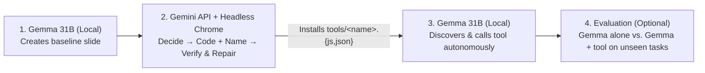

# Agent Boost

**Agent Boost** is a live cross-model tool-synthesis system: **Gemma 4 31B** (running locally via `llama.cpp`) creates a baseline slide, **Gemini** (via the Gemini API) turns a plain-English capability request into a browser-verified, reusable slide-rendering tool on the fly, and **Gemma** discovers and calls that tool on its own—both on the original slide and across unseen requests.



## Quick Start

### 1. Prerequisites

- **Node.js** (v22+ recommended; uses built-in `http`, `fetch`, `WebSocket`, and `child_process`—zero server dependencies)
- **Google Chrome** installed locally (driven headless over raw DevTools Protocol to verify generated slides offline)
- **`llama-server`** (`llama.cpp`) serving Gemma 4 31B locally on port `8099`
- **`GEMINI_API_KEY`** in `.env` at the repo root (read only by `server.js`; never sent to the browser)

### 2. Start the Local Gemma Server (~6.5 s warm per slide)

Run Gemma 4 31B with the E2B model as a speculative draft and reasoning turned off (tuned for short HTML/JSON output):

```bash
llama-server -m ~/models/gemma-4/gemma-4-31B_q4_0-it.gguf --host 127.0.0.1 --port 8099 \
  --jinja --reasoning off -np 1 -c 4096 -ngl 99 --flash-attn on \
  --spec-type draft-simple -md ~/models/gemma-4/gemma-4-E2B_q4_0-it.gguf -ngld 99 \
  --spec-draft-n-max 5 --spec-draft-p-min 0.8
```

### 3. Install & Run Agent Boost

```bash
npm install      # Installs Three.js 0.170.0 solely to serve /vendor/three/ offline
node server.js
```

Open `http://127.0.0.1:3000` in your browser.

You can also run Gemma's slide harness directly from the CLI:

```bash
node gemma-generate.js "Create a 2027 go-to-market roadmap slide"
node gemma-generate.js --tools "Create a 2027 go-to-market roadmap slide"
```

---

## Workflow (Browser UI)

The single-screen viewer (`public/index.html`, `public/app.js`, `public/styles.css`) displays a header with an **`(i)` architecture diagram modal**, three step pills with live timings, a single context-sensitive action bar, and side-by-side `1280×720` slide viewports (**Original** on the left, **Improved** on the right). Throughout the UI, local **Gemma** is marked in teal (`●`) and **Gemini** (plus any tool it builds) in violet (`✦`).

1. **Step 1 — Create baseline slide (`Gemma creates`).**
   Enter a slide prompt (default: *"Create a 2027 go-to-market roadmap slide"*). Starts a fresh run (clearing prior slides, tools, and evaluation outputs), spawns `gemma-generate.js` without tools, streams live section milestones, and renders Gemma's plain HTML/CSS slide in the left viewport (`public/gemma-slide.html`).
2. **Step 2 — Build a reusable tool (`Gemini builds a tool`).**
   Enter a visual or interactive capability request (default: *"Add interactive 3D visualization to slides"*). `server.js` orchestrates a 5-stage pipeline directly over the Gemini REST API and headless Chrome:
   1. **Decide (`gemini-decision-1`, ~0.3 s)** — Rejects URLs/network requests deterministically, then makes one Gemini Decisions API call to classify whether a self-contained slide tool can fulfill the request (calibrated choice + confidence) and which measurable capabilities (`3D`, `Interactive`, `Colorful`, `Animated`) it requires. Unsupported requests (new/translated text, external data, images/audio/video, network access) stop immediately with an explanation.
   2. **Design & code (`gemini-4-hydrogen`, low thinking, streamed)** — Uses `AGENTS.md` as system instructions to design and write a compact CommonJS HTML generator in one pass. Streamed thought headings (`**…**`) and code-feature detections appear live in the right panel.
   3. **Name & describe (`gemini-4-neon`, low thinking, in parallel)** — Runs concurrently with Hydrogen to generate a verb-first `snake_case` function name and a concise description (`<= 25` words) for Gemma's tool schema.
   4. **Test in headless Chrome (`page-check.js`)** — Executes the candidate module on both **Gemma's slide** and an **unseen smoke-test slide** (*"Product Launch Plan"*, with uneven bullet counts), blocks external URLs, and measures both rendered pages offline at `1280×720` for runtime errors, exact text presence, framing/clipping/overlap, and every requested capability. Genuine failures are sent back to Hydrogen with actionable diagnostics for up to **2 automatic repair turns**.
   5. **Verify claims & install (`tools/<name>.js` + `.json`)** — Audits Neon's proposed name and description so they never claim a capability the browser test did not verify (replacing unverified claims with a deterministic fallback), then atomically installs the tool into `tools/`.
3. **Step 3 — Autonomous discovery & retry (`Gemma uses it`).**
   Runs `gemma-generate.js --tools` on the original slide conversation, asking Gemma to remake the same slide with exact text preservation while offering all installed `tools/` (`tool_choice: "auto"`—the prompt never names any tool). Gemma decides on its own whether to call the tool; the harness executes the call, checks for any text drift from Step 1, and writes `public/gemma-tool/index.html` and `public/gemma-tool/run.json`.
4. **Step 4 — Unseen-request evaluation (optional, ~45 s).**
   Evaluates whether the newly built tool generalizes beyond the original slide:
   - Re-checks the **original** slide pair on disk, then runs **3 unseen slide prompts** (*startup hiring plan*, *bank cloud migration roadmap*, *2027 sustainability goals*, deduplicated if matching Step 1).
   - For each unseen prompt, Gemma generates the slide **alone** and **with the tool available** (`public/eval/task-N/`), and headless Chrome measures both pages.
   - Replaces the slide stage with a live comparison matrix (**Gemma alone** vs. **Gemma + `<tool>()`** across `Called`, `Text`, `In frame`, `No errors`, active capability checks, and `Time`), with a toggle button to switch between **Show slides** and **Show test results**.

Clicking **Details** on either panel opens the full technical log (model IDs, decision probabilities, stage latencies, browser check metrics, raw tool-call JSON, and content-diff checks). Refreshing while a step is active reconnects to the live run; refreshing while idle presents a clean starting screen; clicking **New run** (`POST /api/reset`) terminates active child processes/streams and removes all generated run artifacts.

---

## Architecture & Implementation

### Repository Structure

| Path | Role |
| :--- | :--- |
| `server.js` | Zero-dependency HTTP server (`127.0.0.1`), confined static file router, Step 2 Gemini synthesis & repair orchestrator, Step 1/3 Gemma process runner, Step 4 evaluation runner, and `GET /api/status` state provider. |
| `gemma-generate.js` | CLI/child-process harness for local Gemma 31B (`/v1/chat/completions` SSE): baseline HTML body generation, CSS-shell wrapping, `tools/` discovery, OpenAI function-call execution, content-diff verification, and `--stream` NDJSON progress events. |
| `page-check.js` | Zero-dependency headless Chrome verifier using raw Chrome DevTools Protocol (CDP) over `WebSocket` to measure errors, exact text visibility, DOM/3D framing, color vividness, idle motion, and real hover/drag interactivity offline. |
| `AGENTS.md` | System prompt read dynamically on every build for `gemini-4-hydrogen`: defines the CommonJS interface, `<= 100`-line code budget, typography/light-theme rules, 3D bounding-box camera fitting algorithm, and local Three.js import map. |
| `public/index.html` | Single-screen viewer markup, Original/Improved slide panels, evaluation table view, and the `<dialog id="arch">` 4-stage architecture diagram. |
| `public/app.js` | Vanilla JS polling client (`150 ms` active / `400 ms` idle), clock-synced live timers, `ResizeObserver` `1280×720` iframe scaler, live stage/milestone renderer, details drawer, and evaluation matrix builder. |
| `public/styles.css` | Presentation light theme using CSS custom properties, CSS Container Queries (`100cqw` / `100cqh`) for 16:9 side-by-side scaling, and Gemma/Gemini color coding. |
| `tools/` | Gitignored directory where verified `<name>.js` and `<name>.json` pairs are installed at runtime (never web-served). |

---

### 1. Fast Local Slide Generation & Tool Calling (`gemma-generate.js`)

- **Token-minimal baseline markup:** Without `--tools`, Gemma is instructed (`SYSTEM_PROMPT`) to output *only* minified HTML body markup (`<header><h1>…</h1><p>…</p></header><main><section>…</section>×4</main>`) with `temperature: 0.2`, `max_tokens: 400`, `chat_template_kwargs: { enable_thinking: false }`, and `stop: ["</main>"]`.
- **Fixed CSS shell (`BASE_SLIDE_CSS`):** Quarter labels (`Q1`–`Q4`) are injected via CSS counters (`counter-increment: q; content: "Q" counter(q)`) so Gemma spends zero tokens emitting labels. `validBody()` restores the stripped `</main>` stop token and enforces `<h1>`, `<main>`, and exactly 4 `<section>` elements before saving both `gemma-raw.html` (raw model output) and `gemma-slide.html` (wrapped 16:9 page).
- **Multi-turn exact-content retry (`--tools`):** Reads `gemma-raw.html` and continues the conversation (`[system, user, assistant: originalHtml, user: RETRY_PROMPT]`) while passing all discovered `tools/*.json` schemas with `tool_choice: "auto"`.
- **Validation & diffing:** Rejects leaked Gemma delimiter tokens (`<|` in streamed tool arguments), parses JSON arguments, decodes HTML entities and normalizes whitespace to compute `contentDifferences(original, args)` across title, subtitle, quarter count, themes, and bullet points, executes `tool.run(args)`, and writes `run.json` *before* `index.html` so directory-signature polling never observes a half-written output directory.
- **Speculative decoding telemetry:** Captures `timings.draft_n_accepted` and `timings.draft_n` alongside `firstTokenMs`, `generationMs`, `tokensPerSec`, and `toolMs`.

---

### 2. Gemini Tool-Building Pipeline (`server.js` + `AGENTS.md`)

All Gemini calls go directly to `https://generativelanguage.googleapis.com/v1beta` using Node's native `fetch` and SSE stream parsing (`geminiApi`, `geminiStream`):

- **Single-call Decisions gate (`decide`):** Sends one `POST /v1beta/decisions` request (`models/gemini-decision-1`) containing five structured queries:
  - `supported` (`type: "choice"`): calibrated classification (`supported` vs. `unsupported`) + `confidence`.
  - `three_d`, `interactive`, `colorful`, `animated` (`type: "noul"`): probability scores; each capability with `noul > 0.5` becomes a required requirement in Hydrogen's prompt and a hard gate in `testTool()`.
- **Live streaming milestones:** While `gemini-4-hydrogen` streams SSE parts (`includeThoughts: true`), bold headings in `part.thought` update a single in-place thinking indicator (`Hydrogen: …`), while regex matchers (`CODE_MILESTONES`) scan streamed code inside the ```` ```js ```` block to surface implementation milestones (e.g., `OrbitControls`, `CSS2DRenderer`, `userData.milestone`, `getBoundingClientRect`).
- **Two-case sandboxed testing & self-repair:**
  - Writes candidate code to `tools/.candidate.js` (invisible to `loadTools()` because it has no `.candidate.json`).
  - Runs the module in child Node processes (10 s timeout) on `slideContent('public/gemma-raw.html')` and `TOOL_SAMPLE`, scans the output HTML to reject external `http(s)://` URLs (allowing only `www.w3.org` XML/SVG namespaces), and serves the temporary HTML files from `$TMPDIR/agent-boost-tool-test/` at `/tool-test/{slide,unseen}.html` for headless Chrome inspection.
  - If any base or capability check fails, `failureOf()` formats a specific error message and appends the failed turn + diagnostic prompt to Hydrogen's conversation history (up to `MAX_REPAIRS = 2`, bounded by a `240 s` overall `AbortController` timeout).
- **Capability-verified naming (`verifiedIdentity`):** Even if a tool passes all requested checks, Neon runs in parallel before testing finishes and might over-claim capabilities. `CLAIMS` regex-tests Neon's proposed `name` and `description` against `build.verified` (capabilities that passed on *both* test cases) and substitutes a deterministic `render_<caps>_slide` name/description if any unverified capability is mentioned.

---

### 3. Offline Visual & Interactive Verification (`page-check.js`)

Rather than relying on LLM self-critique or heavy test frameworks, `page-check.js` drives **headless Chrome** (`1280×720`, SwiftShader WebGL) over raw CDP WebSocket sessions:

- **Strict offline isolation:** Launches Chrome with `--host-resolver-rules=MAP * ~NOTFOUND , EXCLUDE 127.0.0.1`, ensuring external fonts, scripts, images, or CDNs fail deterministically.
- **Pre-load Three.js instrumentation (`PAGE_HOOK`):** Registered via `Page.addScriptToEvaluateOnNewDocument`, it installs a `window.__THREE_DEVTOOLS__` `observe` listener and wraps `renderer.render(scene, camera)` to record live WebGL scenes and cameras automatically.
- **Settled-layout sampling:** Polls every `300 ms` (up to 12 times after an initial `500 ms` wait) until leaf text element positions change by `< 1.5 px`, allowing intro transitions to settle before judging framing.
- **Measured checks:**
  - **Errors:** Zero uncaught exceptions (`Runtime.exceptionThrown`) or console errors (`Log.entryAdded`, excluding `favicon`).
  - **Text completeness:** Every expected string (`title`, `subtitle`, milestone labels, themes, and points) must appear in a visible leaf DOM element with non-zero dimensions.
  - **Framing & occlusion:** Leaf text cannot clip past `-2 px`; cards (`< 90%` viewport width with background, border, or shadow) must stay `>= 8 px` inside all viewport edges; no card may cover `> 25%` of another card's text bounding box; every Three.js object tagged `userData.milestone = index` has its 8 geometry bounding-box corners projected through `matrixWorld` and `camera` to verify it is in front of the camera (`z <= 1`) and inside `[0, 1280] × [0, 720]`.
  - **3D (`three_d`):** At least 1 rendered Three.js scene and `>= 1` visible object tagged with numeric `userData.milestone`.
  - **Colorful (`colorful`):** Captures a half-scale PNG screenshot via `Page.captureScreenshot`, computes pixel-level HSV on a `<canvas>`, counts vivid pixels (`V >= 0.35`, `S >= 0.45`) across 12 hue buckets (requiring `>= 0.4%` of slide pixels per bucket), and requires **`>= 4` distinct hue buckets** covering **`>= 8%` of the slide**.
  - **Animated (`animated`):** Compares two screenshots taken `400 ms` apart with no user input (`first !== second`), while recording baseline idle text drift.
  - **Interactive (`interactive`):** Dispatches real CDP `Input.dispatchMouseEvent` sequences—hovering the center of the first milestone card (checking for computed style/geometry changes or still-page pixel changes) and dragging `220 px` across an uncovered `<canvas>`/background point in 10 steps (passing if average text position moves `>= 20 px` and `> 3×` idle drift).

---

### 4. Fixed Tool Interface (`tools/<name>.{json,js}`)

Every generated tool shares one fixed schema (`TOOL_PARAMETERS` in `server.js`) so Gemma can discover and call any tool reliably:

- `tools/<name>.json` — OpenAI function definition (`name`, `description`, `parameters`: `{ title, subtitle, milestones }`)
- `tools/<name>.js` — Synchronous CommonJS module with zero external dependencies:
  ```js
  module.exports = function ({ title, subtitle, milestones }) {
    return '<!DOCTYPE html>…';
  };
  ```
- Each entry in `milestones` (2–8 items) is a flat pipe-delimited string `"Label | Theme | point | point | point"`. Keeping milestones flat avoids nested JSON array escaping errors during fast local-model tool calling while remaining trivial for tools to split on `|`.
- For 3D tools, `server.js` serves local Three.js `0.170.0` modules (`build/` and `examples/jsm/`) at `/vendor/three/` with `Cache-Control: public, max-age=86400`, imported via browser `<script type="importmap">`.

---

### 5. HTTP API & Security Boundaries (`server.js`)

- **Endpoints:**
  - `GET /api/status` — Current run state, live stage timers, installed tool list, evaluation results, and mtime/size signatures (`original`, `tool`) that trigger iframe reloads.
  - `POST /api/gemma` — Starts Step 1 (`{ withTools: false, prompt }`) or Step 3 (`{ withTools: true }`).
  - `POST /api/improve` — Starts Step 2 (`{ prompt }`).
  - `POST /api/evaluate` — Starts Step 4 unseen-task evaluation (`{}`).
  - `POST /api/reset` — Stops child processes (`SIGTERM`), aborts active Gemini requests, deletes generated artifacts, and resets server state.
- **Hardening:**
  - Static resolution (`resolvePublicFile`) confines paths via `fs.realpathSync` to `public/`, `node_modules/three/{build,examples/jsm}`, or `$TMPDIR/agent-boost-tool-test`, blocking `..`, null bytes, symlinks escaping roots, and all dotfile segments (including `.env` and `tools/.candidate.js`).
  - All state-changing routes (`readJsonPost`) enforce `Host` allowlisting (`127.0.0.1:<PORT>`, `localhost:<PORT>`), exact same-origin `Origin` header matching (preventing cross-site requests and DNS rebinding), `application/json`, a `4 KB` body cap, and `validPrompt()` (`<= 500` chars, rejecting leading `-` so prompts cannot inject CLI flags into `gemma-generate.js`).

---

## Configuration

Environment variables can be placed in `.env` or passed on the command line:

| Variable | Default | Description |
| :--- | :--- | :--- |
| `GEMINI_API_KEY` | *(required for Step 2)* | Gemini API key used server-side by `server.js`. |
| `PORT` | `3000` | Local HTTP port (`server.js` binds strictly to `127.0.0.1`). |
| `GEMMA_URL` | `http://127.0.0.1:8099` | Base URL of the local OpenAI-compatible `llama-server` used by `gemma-generate.js`. |
| `CODE_MODEL` | `gemini-4-hydrogen` | Gemini model used in Step 2 to design, write, and repair tool code. |
| `CODE_THINKING` | `low` | Thinking level (`low`, `medium`, `high`, `xhigh`) for `CODE_MODEL`. |
| `NAME_MODEL` | `gemini-4-neon` | Gemini model used in parallel in Step 2 to name and describe the tool. |
| `NAME_THINKING` | `low` | Thinking level for `NAME_MODEL`. |
| `CHROME_BIN` | `/Applications/Google Chrome.app/Contents/MacOS/Google Chrome` | Path to the Chrome/Chromium binary launched headless by `page-check.js`. |
